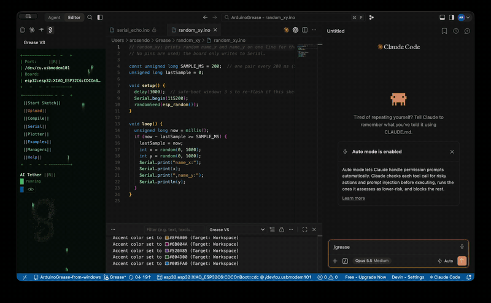
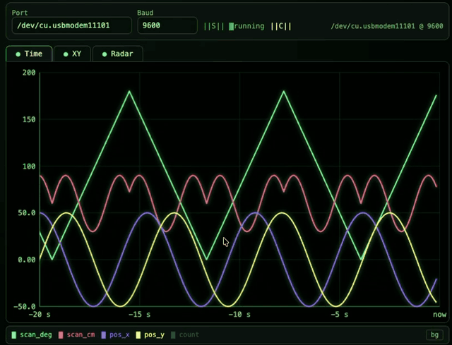
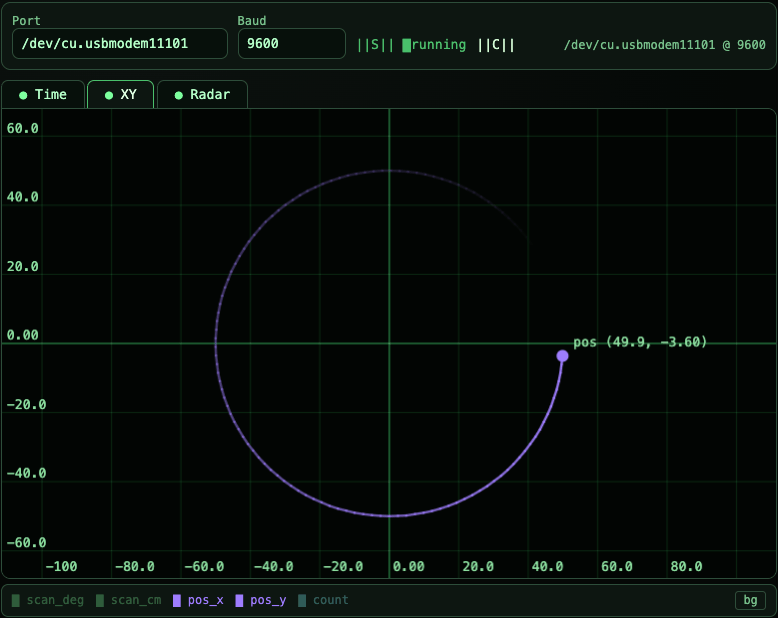
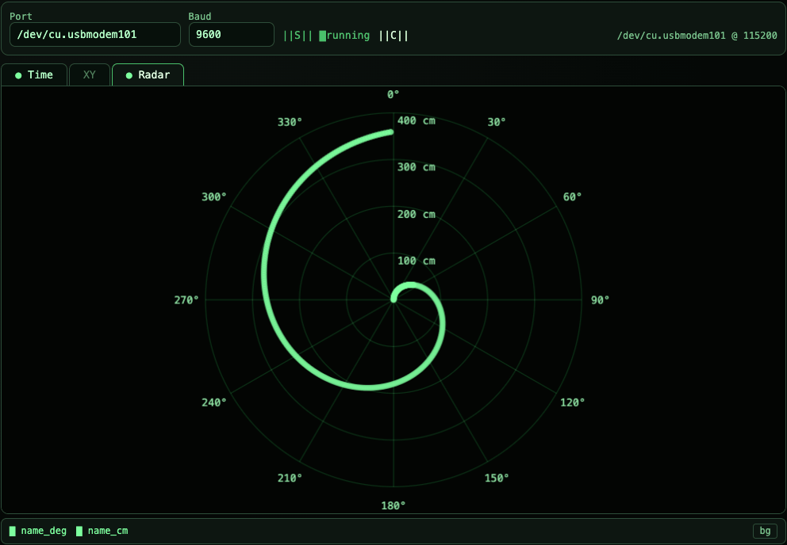
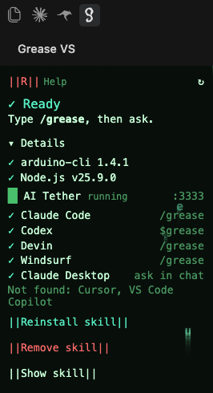
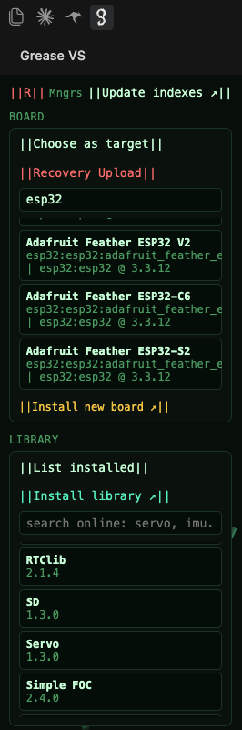

## Grease VS (formerly Arduino Grease)



Grease is a software to build microcontrollers and robots capable of debugging themselves. From LED blinking to Reinforcement Learning experiments, this is an all-in-one solution for your problems.

Grease treats English as the programming language. The more technical and precise your request, the more the agent can build: wiring help, sensor checks, behavior tuning, Bluetooth protocols, inverse kinematics.

AI agents write, compile and upload your sketch, then read the board's serial output; you watch the same output and plots in the sidebar. Grease works with ESP32, RP2350/RP2040, nRF52840 and Arduino boards (the Pololu Romi 32U4 shows up as a Leonardo), inside VS Code, Cursor, Windsurf, Devin and Antigravity. Agents outside the editor (Claude Code, Codex, Claude Desktop) connect to the same board through Grease's local AI Tether.

### Features
- **Plotter, three types.** Time (the traditional one), XY, and Radar. The agent reads the same numbers you see.
- **Installs without the terminal.** Board cores and libraries install from the Managers panel, or the agent installs them when a sketch needs one. arduino-cli installs by itself.
- **An MCP server for your agent.** AI Tether runs on your computer and gives any agent the tools: compile, upload, Serial, Plotter, installs.
- **Any agent.** Use any agent you like: Copilot, Claude, Codex, Cursor, Windsurf. In the Grease VS sidebar open **Help**, press **Add tools** for your agent, restart it, then type `/grease`. The agent reads the Grease Skill and knows what to do.



| XY | Radar |
|---|---|
|  |  |

| Help | Managers |
|---|---|
|  |  |

### Setup
1. Nothing to install by hand. When no `arduino-cli` is found, Grease installs arduino-cli 1.5.1 (17 MB, checksum
   checked) into `~/.grease/bin`, then runs its one-time download of the board list and USB tools (14 MB). A pop-up
   says so. If you prefer your own copy, install it first and Grease uses it:
   - Windows: `winget install ArduinoSA.CLI`
   - macOS: `brew install arduino-cli`
   - Linux: `curl -fsSL https://raw.githubusercontent.com/arduino/arduino-cli/master/install.sh | BINDIR=$HOME/.local/bin sh`
2. Optional: Node.js, needed only for agents outside the editor (Claude Code, Codex, Claude Desktop):
   - Windows: `winget install OpenJS.NodeJS.LTS`
   - macOS: `brew install node`
   - Linux: `sudo apt install nodejs` (Fedora: `sudo dnf install nodejs`)
3. Open the Grease VS sidebar › **Help**. It checks both programs and shows a fix line when one is missing or not on PATH.
4. In **Help › Your agents**, press **Add tools** for each agent you use, then restart that agent.
5. Type `/grease` in your agent (`$grease` in Codex), then ask: "blink the LED on my ESP32-S3".

### What it does
- Runs **AI Tether**, one local process per computer on 127.0.0.1 (port 3333, or the next free one). Agents reach it over MCP; the sidebar buttons use its REST API. Both need the key in `~/.grease/extension/mcp-auth.json`.
- Installs the **Grease Skill** (`/grease`) into `~/.claude/skills` (Claude Code) and `~/.agents/skills` (Codex, Cursor, VS Code Copilot, Windsurf, Devin). Your edits to it stay; **Reinstall skill** replaces them and keeps a `.bak` copy.
- Goes online only to install: arduino-cli and its first-run download, the core a recognized board needs, and the board and library installs marked ↗ in the sidebar. Each one shows a pop-up; agents get the same line in `notices`. Everything else stays offline.
- Picks the board by itself when exactly one known board is connected, the Romi 32U4 and RP2350B boards included, without asking the Arduino cloud.
- Sidebar: Compile, Upload, Serial, Plotter, Examples, Managers and Help.

### 2.0.0 — Changes
- **Renamed Grease VS.** The extension ID stays `RobotFab.arduino-grease`, so updates and links keep working.
- **Help panel** replaces the AI Prompt tab: setup checks, AI Tether, the agents found on your computer, and the skill. There is no prompt to paste.
- **Stdio bridge** (`~/.grease/bin/grease-mcp.mjs`): agent configs no longer hold the key or the port. VS Code gives Copilot the tools directly.
- **Any number of agents at once.** 1.0.13 accepted only the first agent until AI Tether restarted.
- **New agent tools:** `setTarget`, `installCore`, `installLibrary`. `uploadSketch` compiles first, so an agent never flashes the old build.
- **arduino-cli without a shell** on every OS, with a time limit per step. GitHub library installs fixed; errors end with a Why and a What line.
- **One AI Tether per computer.** Every editor window and agent shares it, so the serial port has one owner. Agents start it themselves when no editor is open, and it exits after 10 minutes with no client.
- **Plotter: Time, XY and Radar tabs.** Print `name_x` + `name_y` for XY, or `name_deg` + `name_cm` for Radar (0° up, clockwise). A tab gets a ● when its pairs appear. The Plotter no longer takes lines from the Serial Monitor or an agent. Agents read the same numbers with `readPlot`, and `plotSnapshot` returns a PNG of the plot. `openPlotter` shows the live Plotter in chats that draw MCP Apps, and returns a local link to the same Plotter for agents that do not, such as Claude Code. `listBoards` gives agents the installed cores and each board's FQBN.
- **Necessary installs run by themselves**, each with a short pop-up: arduino-cli 1.5.1 when none is found, its first-run download (once, with a long time limit; offline it used to fail silently inside a 30 s board scan), and the core for a recognized board (with Cancel).

### Inspiration

This was inspired by my work in 2015 on the "Mother Robot" a system that could build and improve its own "children."

The robots couldn't effectively see what was happening in the real world, relying on us to be their sensors and set goals. Now they can debug themselves, while we concentrate on setting their goals.

### Install (VSIX / VSX)
1. Build and package:

```bash
npm install
npm run build
npx @vscode/vsce package --allow-missing-repository
```

2. Install the generated `arduino-grease-2.0.0.vsix` from your IDE's extension installer (VS Code/Cursor/Antigravity/Other VS-based IDEs).

### Earlier versions

#### v1.0.13
- **IDE detection**: `getState` returns the host IDE name (VS Code, Cursor, Windsurf, Antigravity, etc.) so agents no longer guess extension folder paths.
- **AI Prompt rewrite**: the sidebar prompt template guided agents to call `readSkill` and `getState` first.

#### v1.0.11
- **Upload pipeline fixed**: the bundled server was missing the `/compile` and `/upload` REST routes. Rebuilt from source.
- **Process timeout**: unresponsive `arduino-cli` / `bossac` processes were killed after 30 s.

#### v1.0.6
- **Serial Plotter Legend**: a color legend for each data series; labeled streams (`sensor = 123, output = 456`) parsed automatically; a **bg** button toggles the background.
- **Plotter Opens in New Window** on the first click.

#### v1.0.5
- **Arduino Syntax Highlighting**: TextMate grammar for `.ino` files.
- **Grease & Graphite Themes**, auto-applied on install. Activity bar moves to top.
- **Accent Color Cycling** and **Serial Auto-Disconnect** when opening Managers or Examples.

### Credits

As I always told my students, "If mechanical engineers are the knights, and computer scientists are wizards, then we roboticists are the paladins." 

Designing algorithms is getting easier, and the next frontier is practical/experimental. The real Robotics' bottleneck is where code meets metal.

This package was developed by [Prof. Andre Rosendo](https://www.wpi.edu/people/faculty/arosendo). Freeware, open under the MIT license, provided "as is", without warranty.
